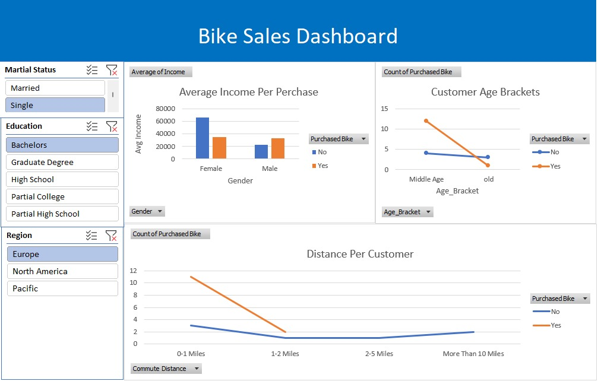

# 🚲 Excel Bike Sales & Customer Demographics Dashboard

## 📌 Project Overview
This project features an interactive Excel dashboard built to analyze customer demographic data and determine the key factors that drive bike purchases. It transforms raw customer data into actionable business insights using Pivot Tables, Pivot Charts, and dynamic Slicers.

## 📊 Dashboard Preview

🔗 **Excel Workbook File:** [Excel Project Dataset.xlsx](Excel%20Project%20Dataset.xlsx)

## 🎯 Key Business Questions Answered
* **Income vs. Purchases:** How does average customer income affect whether they purchase a bike, broken down by gender?
* **Age Demographics:** Which age brackets (Middle Age, Old, Adolescent) show the highest conversion rate for bike purchases?
* **Commute Distance:** How does commuting distance impact customer purchasing behavior?
* **Demographic Filtering:** How do marital status, education level, and geographic region influence overall sales trends?

## 🛠️ Tech Stack & Skills Demonstrated
* **Tool:** Microsoft Excel
* **Core Functions & Features:** 
  * Data Cleaning & Standardization (Handling blanks, normalizing text values)
  * Pivot Tables & Pivot Charts (Bar charts, line trends)
  * Interactive Slicers (Marital Status, Education, Region)
  * Dynamic Dashboard Layout & Formatting

## 💡 Key Insights
* Married customers and individuals with a Bachelor's degree form the largest customer segments for bike purchases.
* Middle-aged customers show significantly higher engagement compared to older demographics.
* Customers with shorter commute distances (0-1 miles) purchase a higher volume of bikes compared to long-distance commuters.
